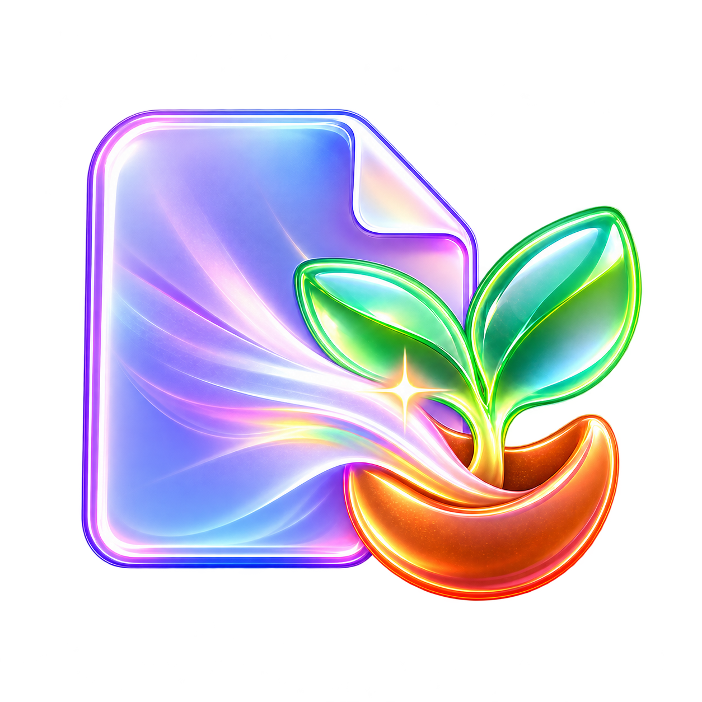
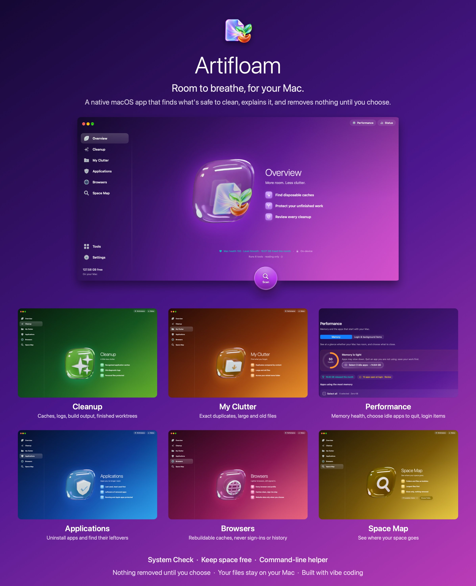

<p align="center">
  
</p>

<h1 align="center">Artifloam</h1>

<p align="center"><strong>Room to breathe, for your Mac.</strong><br>
A native macOS app that finds what's safe to clean, explains it, and removes nothing until you choose.</p>

<p align="center">
  macOS 14+ · Apple Silicon and Intel · No third-party dependencies · 25 languages · <a href="#license">Free and open source</a>
</p>

<p align="center">
  <a href="https://vasquezgroup.ch/artifloam"><strong>Download Artifloam</strong></a>
</p>

<p align="center">
  
</p>

## Why I built this

I run several apps at the same time and develop them with AI. On a normal day there are many Claude Code and Codex sessions open, each in its own worktree, and they leave a lot behind: old checkouts, dependencies, build caches.

It got messy. I lost track of which worktree was which, and had code in one place while the app ran from another. The cleaners I tried didn't help, because they don't know what a worktree is or whether it still holds unfinished work, and I wanted something that could clean on its own without me worrying about it.

So I built Artifloam. It started as a small tool for my own Mac, and it's still strict for that reason: if something might still matter, it stays.

**The name:** *artifact* + *floam*. Artifacts are what builds and tools leave behind, and floam is the foam they turn into, piling up on top of your work.

## What it does for you

- **You stay in charge.** Scans only read. Nothing is removed until you choose it.
- **Your files stay on your Mac.** Files, file names and scan results are never sent anywhere.
- **Careful by design.** Every item is checked again right before removal. Anything in use, changed since the scan, tracked by Git or holding credentials is kept.
- **Made for developers too.** It understands build caches, dependencies and Git worktrees, including those left behind by AI coding tools.

## Features

| Area | What it does |
| --- | --- |
| **Cleanup** | Caches, logs, build output, finished worktrees and the Trash |
| **My Clutter** | Exact duplicates and large or old files, moved to the Trash after review |
| **Performance** | Memory use, choosing which idle apps to quit, login and background items |
| **Applications** | Uninstalling apps and finding their leftovers |
| **Browsers** | Rebuildable browser caches, kept separate from sign-ins and history |
| **Space Map** | A visual map of what's using your disk |
| **System Check** | A plain-language look at your Mac's security settings |
| **Keep space free** | Optional automatic cleanup of things that rebuild themselves, off by default |

There's also a command-line helper, `stewardctl`.

## Languages

Artifloam follows your Mac's language, and you can choose another in Settings. It's available in 25 languages and regional variants:

العربية, Català, Deutsch, English (US, Australia, Canada, UK), Español (España, Latinoamérica), Français, Schwiizertüütsch, हिन्दी, Hrvatski, Italiano, 日本語, 한국어, Latviešu, Polski, Português, Shqip, Српски, Srpski, Svenska, Türkçe, 简体中文.

These are machine translations, not yet reviewed by native speakers, so some wording may be off. Corrections and new languages are very welcome as pull requests. See [how to help](CONTRIBUTING.md#translations).

## Install

Download Artifloam from [vasquezgroup.ch/artifloam](https://vasquezgroup.ch/artifloam), open the disk image, and drag **Artifloam** to Applications.

### Permissions

All are optional, and macOS always asks you first.

| Permission | Why |
| --- | --- |
| Full Disk Access | Measures protected folders such as the Trash and browser data |
| Finder and System Events | Empties the Trash and manages login items when you ask |
| Desktop, Documents and Downloads | Measures storage and finds duplicates |

## Privacy

Official builds connect to the internet for two things only:

1. **A daily update check.** Updates install only when you click, and only after passing the checks in [SECURITY.md](SECURITY.md).
2. **An anonymous monthly count, only if you turn it on** in Settings. It sends the app version, macOS version and chip type, with no identifier.

Like any website, the host may keep standard server logs of those visits. **Builds you make yourself connect to nothing.**

## Build from source

You need Xcode 16 or later and macOS 14 or later.

```sh
swift test                  # run the tests
swift run MacSteward        # run the app
swift run stewardctl scan   # read-only scan from the command line
./scripts/package-app.sh    # build dist/Artifloam.app, signed for this Mac only
```

## Forks

You're welcome to fork Artifloam, and pull requests are welcome too. If you distribute your own fork:

- **Change the bundle identifier** in `scripts/package-app.sh` and `StewardPreferences.domain`, so it doesn't collide with official builds.
- **Use your own name and artwork.** The Artifloam name, icon and artwork aren't covered by the code license ([details](#license)).
- **Sign it with your own Developer ID.** Forks don't receive Artifloam's updates. To offer your own, generate a key with `scripts/create-feed-key.sh` and point `UpdateFeed` and `UpdateChecker` to your own server.

## Using Artifloam at work

Artifloam is free for everyone, including companies. No license key is needed.

## Built with vibe coding

Artifloam is developed with vibe coding: a person directs the product and reviews the results, while AI tools write much of the code. Because this app removes files, its behaviour is backed by an automated test suite, and its release builds are signed and notarized. Please read the code and judge it for yourself, and report anything you find.

## Contributing

Bug reports, ideas and pull requests are all welcome. See [CONTRIBUTING.md](CONTRIBUTING.md).

## Security

Please don't report vulnerabilities in public. Use [private vulnerability reporting](../../security/advisories/new). See [SECURITY.md](SECURITY.md).

## License

Artifloam's source code is open source under the [Apache License 2.0](LICENSE). You can use, change and share it, including commercially.

The Artifloam name, icon and artwork are not covered by that license. They're included so that you can build the app for yourself. See [NOTICE](NOTICE).
